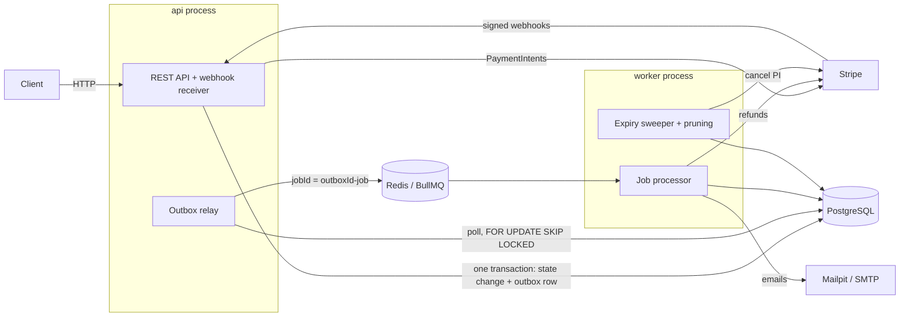
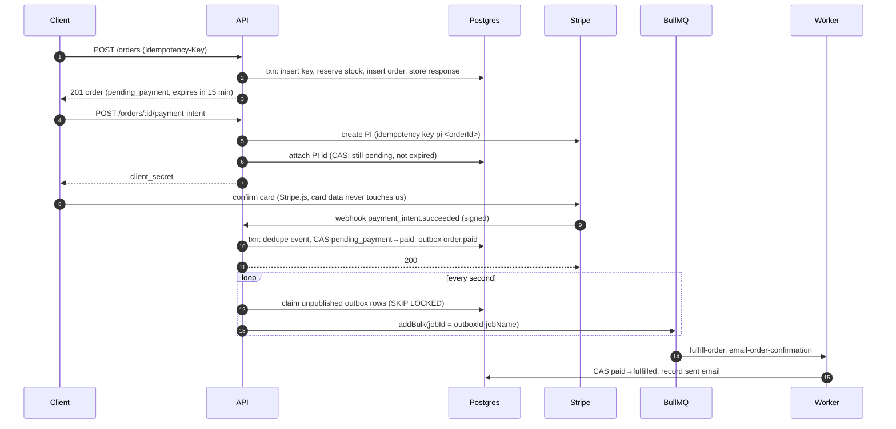
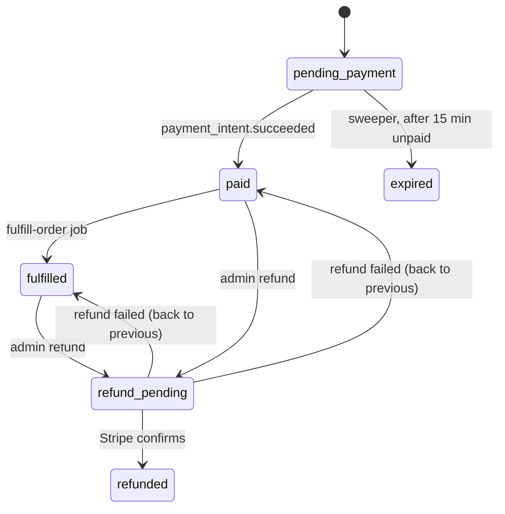

# Order & Payment Service

[](https://github.com/Youssefbarsoum/payment-service/actions/workflows/ci.yml)

A NestJS backend that takes orders for limited-stock products, charges them through **Stripe** (test mode) and fulfills them asynchronously. It stays correct when things go wrong.

It is built around the failure modes real payment systems hit: double-clicks and client retries, two buyers racing for the last item, webhooks that arrive late, twice, out of order or forged, crashes between "saved to the database" and "told the queue", and email or Stripe outages. Each one is handled deliberately and **covered by a test that reproduces it** against real Postgres and Redis.

**Highlights**

- **Idempotency keys** on every mutating client endpoint. A concurrent duplicate waits on a unique index and then replays the original response.
- **Atomic stock reservation**: `UPDATE … WHERE stock >= qty` plus a `CHECK (stock >= 0)` constraint, with product rows locked in id order so concurrent orders can't deadlock.
- **Stripe PaymentIntents and webhooks**: signature verification on the raw body, dedupe by event id in the same transaction as the state change, and compare-and-set transitions that turn duplicate and out-of-order events into no-ops.
- **Transactional outbox** published to **BullMQ** with `FOR UPDATE SKIP LOCKED` and deterministic job ids.
- **Retries with exponential backoff**, plus a dead-letter queue you can inspect and replay over an admin API.
- **Refunds and expiry**: refunds are processed asynchronously. Unpaid orders expire and release their stock, and payments that land too late or for the wrong amount are refunded automatically.
- **98 tests**, including concurrency tests. A load test sends 500 buyers at 50 items and confirms nothing is oversold.

---

## Architecture



There's one codebase with two processes. **Postgres is the source of truth.** Redis only carries work. If Redis loses its data, every state that matters can be rebuilt from Postgres: unpublished outbox rows are re-published, order expiry is swept from Postgres, and refunds still `requested` and orders still `paid` are re-queued by a recovery sweep. Only an email whose job was lost after publishing would be skipped. Redis runs with AOF to make that rare.

## The payment flow



## Order state machine



Every transition is a **compare-and-set**, `UPDATE orders SET status = $to WHERE id = $id AND status IN ($from)`. A transition that loses a race updates zero rows and does nothing. That single rule makes duplicate webhooks, out-of-order webhooks and the "payment lands while the order expires" race safe.

The order status describes the order, and **the refund row describes the money**. Automatic refunds (late payment, wrong amount) don't change the order status: an expired order stays expired, and its refund row records that the money went back.

## What happens if…

| Situation | What protects it | Test |
|---|---|---|
| 20 people buy the last item at the same moment | Conditional decrement + `CHECK (stock >= 0)` | `orders.int-spec` |
| Two multi-item orders lock products in opposite order | Rows locked in product-id order | `orders.int-spec` |
| The user double-clicks "Pay", or the client retries after a timeout | Idempotency key: the duplicate blocks on the PK, then gets the stored response | `idempotency.int-spec` |
| Same key, different body | `422 idempotency_key_mismatch` | `idempotency.int-spec` |
| Crash between Stripe creating the PaymentIntent and our DB write | Stripe idempotency key `pi-<orderId>` returns the same PI | `payment-intents.int-spec` |
| Stripe is unreachable when paying | `502`, order unchanged, retry reuses the same Stripe idempotency key (Stripe replays a stored *error* for 24h, so a request Stripe executed and then failed keeps failing; a connection error is retried cleanly) | `payment-intents.int-spec` |
| Webhook delivered twice (or 5× concurrently) | `webhook_events` PK, deduped in the same transaction | `webhooks.int-spec` |
| Webhooks out of order (failed after succeeded) | Compare-and-set ignores stale events | `webhooks.int-spec` |
| Forged or tampered webhook | Signature check over the raw body | `webhooks.int-spec` |
| Handler crashes mid-webhook | The dedupe row rolls back too; Stripe's retry reprocesses | `webhooks.int-spec` |
| Crash after commit, before enqueueing the job | The outbox row is still unpublished, and the relay picks it up | `outbox-relay.int-spec` |
| Crash after enqueueing, before marking published | Deterministic `jobId` dedupe + idempotent consumers | `outbox-relay.int-spec` |
| Two API instances relaying at once | `FOR UPDATE SKIP LOCKED` | `outbox-relay.int-spec` |
| SMTP or Stripe down while a job runs | 5 attempts with exponential backoff, then the failed set (DLQ). Exhausted retries never become a business outcome: the work is re-queued from Postgres after 10 min | `queue-retries.int-spec` |
| A job is retried after a partial run | Emails are deduped by job id; fulfillment is a CAS | `jobs.int-spec` |
| Admin clicks "refund" 5 times | Row lock + partial unique index: one live refund per order | `refunds.int-spec` |
| Stripe reports a refund as failed | Refund marked failed, order restored (re-queuing fulfillment if it was paid), admin can retry |
| The refund job exhausts its retries (Stripe outage) | Refund stays `requested`; the recovery sweep re-queues it with the same Stripe idempotency key | `refunds.int-spec` |
| Refund webhook arrives before we saved the Stripe refund id | Matched by `metadata.refund_id` | `refunds.int-spec` |
| Payment amount doesn't match the order | Not marked paid; refunded automatically | `refunds.int-spec` |
| Order expires while the customer is paying | Sweeper cancels the PI first; waits up to 1h for a processing payment | `maintenance.int-spec` |
| Payment lands after the order expired | Refunded automatically (`late_payment`) | `maintenance.int-spec` |
| Redis loses its data | Expiry and stale-work recovery are driven by Postgres; Redis runs with AOF | `maintenance.int-spec` |
| Redis hangs (down, not refusing) | Relay and health check use deadlines: the relay rolls back and retries, `/health` returns 503 | `outbox-relay.int-spec`, `health.int-spec` |

## Design decisions and trade-offs

- **The outbox instead of "save, then publish".** A crash between the DB commit and the queue call would silently lose the fulfillment or email. The outbox makes the event part of the same transaction.
- **At-least-once, with idempotent consumers.** Exactly-once delivery isn't something a queue can promise, so every consumer is safe to run twice. **Emails are the one accepted exception**: a crash between the SMTP send and recording it re-sends one email. Recording before sending could lose the email instead, which is worse.
- **Failed requests aren't stored under their idempotency key.** An `out_of_stock` response rolls back with everything else, so retrying the same key later can succeed. Stripe stores errors too; for a shop, retryable is friendlier.
- **Job-id dedupe has a window.** BullMQ keeps completed jobs for 7 days. Beyond that window, consumer idempotency is the guarantee.
- **Refunds return `202` and run in the worker.** A Stripe outage delays a refund but doesn't lose it: exhausted retries leave it `requested`, and a Postgres sweep re-queues it. Only Stripe saying "failed" marks it failed.
- **A duplicate idempotent request waits rather than fails.** It holds a DB connection while blocked on the first request's key. That is fine for normal retries; a retry storm on one slow key could tie up the pool, and returning `409 in progress` via `lock_timeout` (as Stripe does) is the next step.
- **Why BullMQ, not RabbitMQ or Kafka?** The need is background jobs with retries, backoff and a DLQ inside one service, and BullMQ gives all of that on Redis. If order events had to fan out to other teams' services, I'd publish from the same outbox to Kafka. Only the relay would change.
- **Plain modules, not hexagonal layers.** Transactions are visible in the code where they happen. Shared rules (`casOrderStatus`, `enqueueOutbox`, `withIdempotency`) are small functions that take a transaction.

## Running it

**Prerequisites:** Node 24, Docker, and a [Stripe test-mode account](https://dashboard.stripe.com/test/apikeys) (plus the [Stripe CLI](https://docs.stripe.com/stripe-cli) for real webhooks).

```bash
cp .env.example .env              # add your sk_test_ / pk_test_ keys
docker compose --profile app up --build
```

| URL | What |
|---|---|
| http://localhost:3000 | Test checkout page |
| http://localhost:3000/docs | Swagger / OpenAPI |
| http://localhost:8026 | Mailpit inbox (order emails land here) |

**Real Stripe webhooks:** run `stripe listen --forward-to localhost:3000/webhooks/stripe --events payment_intent.succeeded,payment_intent.payment_failed,refund.created,refund.updated,refund.failed` (newer CLI versions require `--events`; these are the events the app handles), put the printed `whsec_…` in `.env` as `STRIPE_WEBHOOK_SECRET`, then restart the api. Pay with `4242 4242 4242 4242` (succeeds) or `4000 0000 0000 0002` (declined, which sends a payment-failed email).

**Refund an order** (admin):

```bash
curl -X POST localhost:3000/orders/<id>/refunds \
  -H "x-api-key: $ADMIN_API_KEY" -H "Idempotency-Key: $(uuidgen)"
```

**Development mode** (infra in Docker, app on the host; `.env` is loaded automatically. Stop the Docker app first with `docker compose --profile app stop api worker`, since both use port 3000):

```bash
docker compose up -d              # postgres :5434, redis :6379, mailpit :1026/:8026
npm install
npm run db:migrate && npm run db:seed
npm run start:dev                 # api
npm run start:worker:dev          # worker, second terminal
```

## Tests

```bash
docker compose up -d && npm test     # DEBUG_NEST=1 npm test also prints server-side errors
```

There are 98 tests across 14 files. They run against real Postgres and Redis, because mocked databases can't show race conditions. Stripe is replaced at the SDK boundary by an in-memory fake that mimics its idempotency and error behavior, and webhooks are signed with the real SDK. CI runs lint, build and the full suite on every push.

**Load check** (stack running): `npm run load-test`

```
500 buyers (100 in flight at once), 50 in stock…
status codes: { '201': 50, '409': 450 }
final stock: 0
PASS: no overselling
```

## API

| Method | Path | Notes |
|---|---|---|
| `GET` | `/products` | Catalog with stock |
| `POST` | `/orders` | `Idempotency-Key` required. Reserves stock for 15 min |
| `GET` | `/orders/:id` | Order, items and refunds |
| `POST` | `/orders/:id/payment-intent` | Idempotent per order; returns `clientSecret` |
| `POST` | `/webhooks/stripe` | Stripe only (signature-verified) |
| `POST` | `/orders/:id/refunds` | Admin (`x-api-key`) + `Idempotency-Key`; `202` |
| `GET` | `/admin/jobs/failed` | Admin: the dead-letter queue |
| `POST` | `/admin/jobs/:id/retry` | Admin: replay a failed job |
| `GET` | `/health` | Postgres + Redis |

## Project structure

```
src/
  orders/        order creation, stock reservation, casOrderStatus (the state machine)
  idempotency/   withIdempotency + Idempotency-Key header
  payments/      Stripe client, PaymentIntents, webhook receiver and handler
  refunds/       admin and automatic refunds, refund outcomes
  outbox/        enqueueOutbox + relay (Postgres → BullMQ)
  jobs/          worker: job processor, fulfillment
  email/         dedupe-guarded emails
  maintenance/   expiry sweeper, retention pruning
  admin/         API-key guard, DLQ endpoints
  db/            Drizzle schema, migrations runner, seed
  main.ts        api process      worker.ts   worker process
test/            integration tests, FakeStripe, signed-webhook helpers
drizzle/         SQL migrations
docs/            design document and implementation plan
```

## What I'd add for production

- Metrics and tracing (OpenTelemetry), and alerting on failed refunds and DLQ growth.
- Outbox publishing via logical replication / CDC (Debezium) instead of polling.
- Real authentication for customers and admins; per-key rate limiting.
- Partial refunds, multi-currency and tax.
- A reconciliation job comparing Stripe's balance transactions with our payments table.
